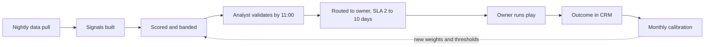

# Support Revenue Engine: Standard Operating Procedure

Owner: Head of Product Support. Version 1.0, November 2026. The live, editable copy of this SOP is kept as a shared document; this file is the version that ships with the code.

## 1. Purpose and scope

This SOP turns a 100-engineer product support organisation into a source of retained and new revenue. Support already sees every escalation, every frustrated comment and every new question a customer asks. The operating model below reads those signals every day, predicts which accounts are drifting toward churn and which are ready to buy more, and routes each one to a named owner with a deadline.

The model covers two B2B client accounts. Both names are fictional and stand in for the real support model of each platform.

| Client | Platform model | Accounts covered | Avg account ARR (assumed) | Tickets per month | Engineers |
| --- | --- | --- | --- | --- | --- |
| Lumora CX | Social media and customer experience management SaaS (listening, publishing, care console, AI bots) | 60 enterprise brands | $350K | 2,000 | 35 |
| Streamhaus | Streaming media platform, B2B side (advertisers, telco bundle partners, device makers, content partners) | 40 partners | $600K | 4,000 | 65 |

At these assumptions the portfolio carries $45M of ARR, the support org costs $3.0M a year at a $30K loaded cost per engineer, and the support contracts are worth $3.6M a year. The baseline model run predicts $8.1M of expected ARR at risk, $2.5M of it saveable, and $2.8M of open expansion pipeline. Revenue influenced comes to $3.3M a year, which is 1.1x the cost of the whole support org and 13.7x the $240K cost of the revenue pod that runs this SOP.

The SOP does not replace Customer Success or Sales. Support finds and evidences the signal; Customer Success and Sales own the commercial conversation. What changes is that support stops handing over tickets and starts handing over revenue cases.

## 2. Roles and RACI

A six-person revenue pod is carved out of the existing 100 engineers. No new headcount is needed. The pod has four support analysts (two per client) and two technical account managers (one per client), and it reports to the Head of Product Support.

| Role | Who | What they do in this SOP |
| --- | --- | --- |
| Head of Product Support | Service delivery leader | Owns the SOP, chairs the weekly revenue review, signs off model changes and reports results to the client and to leadership |
| Support analyst (revenue pod) | 4 engineers from the existing team | Runs the daily scoring, validates flags, writes the evidence pack for each flagged account |
| Technical account manager | 2 senior engineers | Runs adoption clinics and seat expansion briefs, owns the customer conversation on product use |
| Support lead per queue | Existing team leads | Triggers the stability swarm for escalation-led risk and tags tickets correctly at closure |
| Engineering manager (client product team) | Client side | Commits fix dates for defects behind red accounts |
| Customer Success Manager | Client side | Owns re-engagement and the success plan |
| Account Executive | Client side | Owns the commercial outcome of every expansion play and every renewal save |

| Activity | Support analyst | TAM | Support lead | Head of Support | CSM | AE | Eng manager |
| --- | --- | --- | --- | --- | --- | --- | --- |
| Ticket tagging and data quality | A | I | R | I | | | |
| Daily scoring and flag validation | R | C | I | A | | | |
| Stability swarm (escalation) | C | I | R | A | I | I | R |
| Adoption clinic | C | R | I | A | R | I | |
| Closed-loop recovery (voice) | C | C | R | A | R | R | C |
| Re-engagement (disengagement) | C | C | I | A | R | R | |
| Seat expansion brief | R | R | I | A | C | R | |
| Use-case surge brief | R | C | I | A | C | R | |
| Model calibration | R | C | I | A | C | C | |

R is responsible, A is accountable, C is consulted and I is informed.

## 3. Signals, data sources and scoring rules

Every account is scored on four churn indicators and two expansion signals. Each churn indicator runs from 0 (healthy) to 1 (severe), and all inputs come from systems support already has access to.

| Indicator | Inputs (last 90 days) | Source system | Starts to score when | Default weight |
| --- | --- | --- | --- | --- |
| Product escalation | Escalations to engineering per 100 tickets, Sev1 tickets per 100, defect reopen rate | Ticketing tool (JSM, Zendesk or ServiceNow) | More than 9 escalations or 3 Sev1s per 100 tickets, or reopen rate above 12% | 0.30 |
| Low adoption | Active seats against licensed seats, modules in use against modules licensed | Product analytics | Seat use below 75% or module breadth below 60% | 0.25 |
| Customer voice | Ticket comment sentiment, average CSAT, mentions of renewal, contract, competitor or cancel | Ticketing tool and CSAT survey | Sentiment below 0.2, CSAT below 4.4, any renewal or competitor mention | 0.25 |
| Customer disengagement | 30-day usage trend, days since last executive touchpoint, champion left | Product analytics and CRM | Usage falling, no exec contact for 120 days, champion change | 0.20 |

| Expansion signal | Rule | What it means |
| --- | --- | --- |
| High adoption of a feature | Seat use at or above 85% of licence | Teams are queuing for access; a seat block is likely |
| Query surge on a use case | How-to tickets on an add-on the account does not own reach 1.8x the previous three-month average, with at least 6 queries in the month | Buying intent is showing in support before it shows in the CRM |

The weighted indicator score passes through a logistic curve, p = 1 / (1 + e^(-12 (score - 0.35))), to give a churn probability for the next renewal. Expected ARR at risk is p times account ARR. Accounts at 40% or above are red, 15% to 40% are amber, and the rest are green. The account's main driver is the indicator that contributes most to its weighted score, and it decides which play the account gets.

Three guard rails apply. A red account is never pitched an expansion until it returns to amber or green. Expansion value is weighted by win rate (30% by default) and by the chance the account stays. Sentiment uses a plain word list so any score can be explained line by line to an account team; an LLM classifier can replace it later without changing anything downstream.

Ticket tagging is the foundation. Every ticket must close with a use case (module or add-on), a category (how-to, defect, outage, access, billing, feature request), a severity and an escalation flag. Support leads audit 20 closed tickets per engineer per month for tagging accuracy, with a target of 95%.

## 4. Operating rhythm

The engine runs every night, an analyst validates every new flag by 11:00 the next morning, and the account has an owner the same day. Outcomes go back into the CRM so the model can be checked against real renewals each month.

| Cadence | When | What happens | Owner | Output |
| --- | --- | --- | --- | --- |
| Daily | 06:00 | Pipeline pulls the previous day's tickets, product usage and CRM fields, rebuilds signals and re-scores all 100 accounts | Automated | Refreshed dashboard and action queue |
| Daily | By 11:00 | Analyst reviews every account that changed band or newly triggered an expansion signal, reads the underlying tickets and confirms or rejects the flag | Support analyst | Validated flags with a one-page evidence pack |
| Daily | By 17:00 | Confirmed plays are assigned in the CRM with owner and start date | Support analyst | CRM task per play |
| Weekly | Monday, 45 minutes | Revenue review: new red accounts, plays past their start date, expansion briefs sent and their status | Head of Support with CSM and AE leads | Decisions and escalations log |
| Weekly | Thursday | Top recurring defects behind red accounts reviewed with engineering | Support lead and Eng manager | Fix dates committed |
| Monthly | First week | Calibration: compare last month's predictions with renewals, downgrades and expansions; adjust weights and thresholds if precision or recall drop below target | Support analyst, approved by Head of Support | Change note and updated assumptions file |
| Quarterly | QBR | Support-influenced revenue report shared with each client: ARR saved, expansion won, product fixes driven | Head of Support | QBR revenue slide |

## 5. Plays and SLAs

Each flagged account gets exactly one retention play, chosen by its main churn driver, and up to two expansion plays. Red accounts start within 2 working days, amber within 7, and expansion briefs within 10.

| Play | Trigger | Owner | Start within | Steps | Done when |
| --- | --- | --- | --- | --- | --- |
| Stability swarm | Product escalation is the main driver | Support lead with Engineering manager | Red 2 days, amber 7 days | 1. Open a war-room on the top recurring defect. 2. Publish an RCA to the customer within 5 working days. 3. Review fix ETA weekly with the customer until closed. 4. Pre-empt related tickets with a proactive status note. | Escalations per 100 tickets back under 9 for 30 days |
| Adoption clinic | Low adoption is the main driver | TAM with CSM | Red 2 days, amber 7 days | 1. Map unused modules and inactive seats. 2. Run two enablement sessions for admins and power users. 3. Switch on in-app guides for the weakest module. 4. Agree a 60-day seat activation target. | Seat use above 75% or the agreed target met |
| Closed-loop recovery | Customer voice is the main driver | Support Director with AE | Red 2 days, amber 7 days | 1. Call the customer sponsor within 48 hours. 2. Take the top three complaints to product triage. 3. Reply in writing on each complaint with a date. 4. Re-survey CSAT after 30 days. | CSAT above 4.4 and no renewal or competitor mentions for 60 days |
| Re-engagement | Disengagement is the main driver | CSM with AE | Red 2 days, amber 7 days | 1. Book an executive QBR within 30 days. 2. Map a new champion if the old one left. 3. Refresh the success plan with two measurable goals. 4. Set a monthly exec touchpoint. | Usage flat or rising for 60 days and a named champion |
| Seat expansion brief | Seat use at or above 85% | TAM, handed to AE | 10 days | 1. Pull seat utilisation and the teams waiting for access. 2. Write a one-page brief with the evidence. 3. Hand to the AE, who proposes a seat block mid-term or at renewal. | AE logs the opportunity in the CRM |
| Use-case surge brief | How-to queries on an unowned add-on at 1.8x baseline or more | Support analyst, handed to AE and Solutions Engineer | 10 days | 1. Group the surge tickets into themes with quotes. 2. Write a brief on what the customer is trying to do. 3. AE and SE offer a scoped demo or a 30-day pilot. | Demo or pilot booked, or the AE records why not |

A client-wide surge (the same add-on surging across many accounts, as the model shows for Conversational AI Bots at Lumora CX and Live Events at Streamhaus) also goes to the client's product marketing team as one brief, since it usually means a release or a market event is driving demand.

Support engineers keep solving the ticket in front of them. The plays run alongside normal ticket work and never delay a fix.

## 6. Handoffs, governance, KPIs and rollout

### Handoff standard

Every handoff to Sales or Customer Success is a CRM task with a one-page evidence pack attached. The pack states the account, the trigger, the three to five tickets that prove it, the customer's own words where they help, the suggested play and the ARR involved. A handoff without evidence is sent back. Support gets credit for revenue influenced only when the AE or CSM logs the outcome against that task, which keeps the numbers honest and auditable.

### Governance

The Head of Product Support owns this SOP and reviews it every quarter. Model changes (weights, thresholds, plays) are proposed by the analysts, logged in a change note with before-and-after precision and recall, and approved by the Head of Support. Customer data stays inside the client's tenant and the support org's approved tooling. Ticket text used for sentiment is never shared outside the account team.

### KPIs

| KPI | Definition | Target after two quarters |
| --- | --- | --- |
| Flag precision | Share of red and amber flags the analyst confirms and the account team agrees with | 80% or more |
| Flag recall | Share of actual churns and downgrades flagged at least 60 days before renewal | 75% or more |
| Play SLA compliance | Plays started within their start-by window | 95% |
| Gross revenue retention | ARR kept from the accounts covered, before expansion | Up 3 points on the prior year |
| ARR saved | ARR on flagged accounts that renewed, as logged by the AE | $2.0M a year across both clients |
| Expansion influenced | Closed-won ARR on opportunities that started from a support brief | $0.8M a year |
| Revenue influenced per support dollar | (ARR saved + expansion influenced) divided by support org cost | 1.0x or more |
| Tagging accuracy | Closed tickets with correct use case, category and severity | 95% |

### Calibration

The default weights and thresholds are starting points. Each month the analysts compare last month's bands with what actually happened at renewal. If precision falls below 80% the thresholds go up; if recall falls below 75% they come down or the weight of the weakest indicator moves. After two quarters there is enough outcome data to fit the weights with a logistic regression.

### 90-day rollout

1. Days 1 to 30, foundation. Agree the ticket tagging standard with both clients, fix tagging gaps, connect the ticketing tool, product analytics and CRM exports, and form the revenue pod. Run the model in shadow mode with no plays.
2. Days 31 to 60, pilot. Turn on retention plays for Lumora CX only. Hold the first weekly revenue reviews and the first monthly calibration. Agree the handoff standard and credit rules with the client's CS and Sales leads.
3. Days 61 to 90, scale. Add Streamhaus and switch on expansion briefs for both clients. Present the first support-influenced revenue report at each client QBR.
4. After day 90, run as business as usual, refit weights after two quarters of outcomes, and propose an outcome-based element in the support contract (for example a share of ARR saved) at the next renewal.
